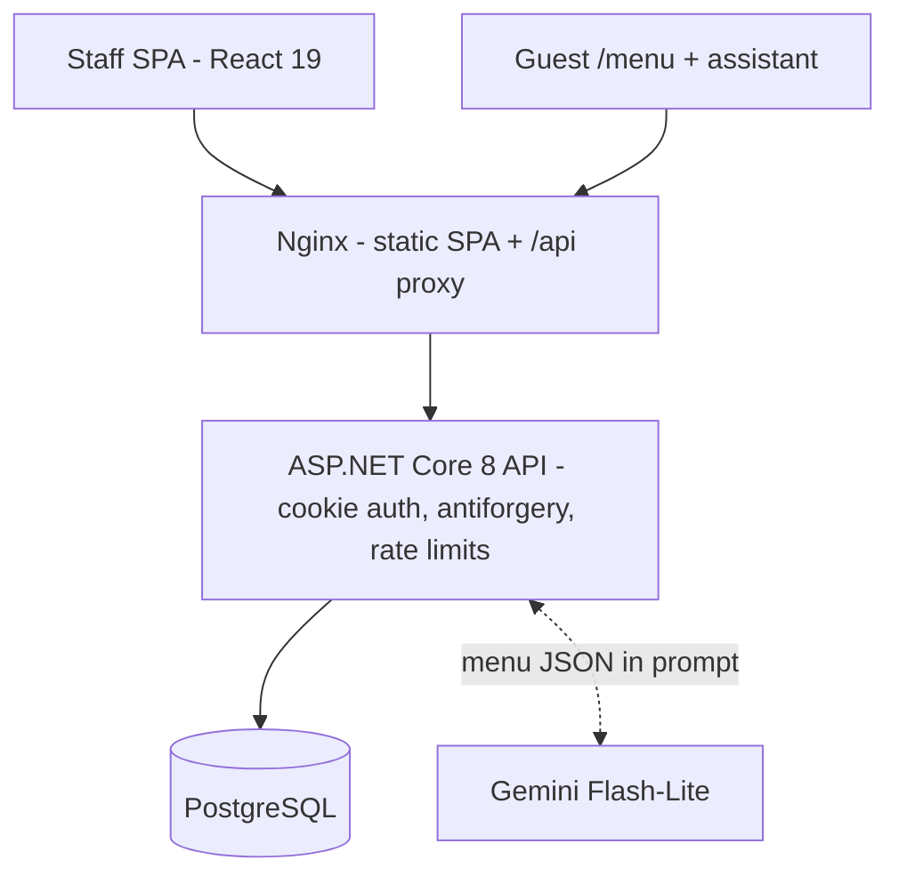

<div align="center">


[](https://dotnet.microsoft.com/)
[](https://react.dev/)
[](https://www.typescriptlang.org/)
[](https://www.postgresql.org/)
[](https://www.docker.com/)

</div>

Chapeau started as an unfinished five-person university project: a WinForms restaurant POS connected to SQL Server. After the course ended I rebuilt it on my own as a web platform, and used it to work through the problems the old version never solved. The original WinForms code is still in the repo (`ChapeauUI/`, `ChapeauService/`, `ChapeauDAL/`, `ChapeauModel/`), so everything old and new is in one place.

- **Live deployment:** http://149.118.68.3 (runs from my own server via Docker Compose; it's online when my machine is)
- **Offline demo:** `cd frontend && npm install && npm run demo`, then open http://localhost:5173/menu — no backend, the API calls are mocked in the browser

Demo PINs (same on both):

| PIN | Role |
| --- | --- |
| 1234 | Waiter |
| 3456 | Chef |
| 4567 | Bartender |

## 📸 What it looks like

| | |
| --- | --- |
|  |  |
|  |  |

<!-- TODO: 录一张核心流程 GIF（开台 → 点菜 → 厨房/吧台 → 结账），10 秒内、5MB 以下，放 docs/images/walkthrough.gif 后取消注释 -->
<!--  -->

Guests order from a public page at `/menu`: browse the menu, add items to a basket with per-line notes, enter their table number, and the order lands in the normal staff flow. Waiters open tables and take orders, the kitchen and bar each get their own queue, and once everything on an order is served the waiter can check it out, which frees the table.

One thing worth trying on the live site: ask the assistant "I'm allergic to nuts — which dessert can I have?" It answers from the ingredient data and still tells you to confirm with your server before ordering.

## 📂 What the repo looks like

The course project and the rebuild live in the same repository on purpose. Here is how they compare:

### 🕰️ Before — the course project

```text
Chapeau/
├── 📄 Project Chapeau.sln
├── 📂 ChapeauModel/               # 3 entity classes
│   ├── 📄 Order.cs                # order + order line merged into one
│   ├── 📄 Employee.cs
│   └── 📄 Table.cs
├── 📂 ChapeauDAL/
│   ├── 📄 BaseDao.cs              # raw ADO.NET, shared SqlConnection
│   ├── 📄 OrderDao.cs
│   ├── 📄 TableDao.cs
│   └── 📄 EmployeeDao.cs
├── 📂 ChapeauService/
│   ├── 📄 IfCorrectChecker_Bogdan.cs   # files named after team members
│   ├── 📄 OrderService_Overview.cs
│   └── 📄 TableService_Bogdan.cs
└── 📂 ChapeauUI/                  # WinForms, one form per screen
    ├── 📄 LoginPage.cs
    ├── 📄 Orders.cs
    ├── 📄 Tables.cs
    └── 📄 ChapeauUI.cs
```

### 🔨 After — the rebuild

```text
Project-Chapeau/
├── 📂 src/
│   ├── 📂 Chapeau.Core/            # entities + enums shared by every layer
│   ├── 📂 Chapeau.Infrastructure/  # EF Core data access, Gemini assistant
│   ├── 📂 Chapeau.Api/             # REST controllers, cookie auth, rate limits
│   └── 📂 Chapeau.Migrations.Postgres/  # versioned database migrations
├── 📂 frontend/                    # React 19 SPA
│   ├── 📂 src/api/                 # typed API client
│   ├── 📂 src/components/          # shared + staff + customer UI
│   ├── 📂 src/pages/               # staff screens + public /menu
│   ├── 📂 src/demo/                # scripted in-browser API mock
│   ├── 📂 src/lib/                 # cart, menu details, formatting
│   └── 📂 src/types/
├── 📂 data/
│   └── 📄 menu-details.json        # allergen/ingredient data for prompt + SPA
├── 📄 compose.local.yaml           # local Docker environment
├── 📄 compose.server.yaml          # server deployment: PostgreSQL + API + Nginx
├── 📄 Dockerfile.api
└── 📄 Dockerfile.frontend
```

What to notice: in the old version the folder names say "layers" but the boundary shows up nowhere in the code, and every domain concept is one flat file. The rebuild separates entities, data access, the API surface and schema migrations, and pairs the API with a real frontend. The four old folders are still in the repo root, so the contrast sits one scroll away.

## 📜 What the old version looked like

The course version had the standard UI / Service / DAL / Model folders and even used parameterised SQL, so it wasn't missing architecture on paper. The problems were in the details:

- The UI sometimes bypassed the service layer when it was convenient.
- The `Order` class mixed order-level and dish-level fields, so an order had one status for the whole table and every dish row carried no price of its own.
- There was no way to create an order end to end, no checkout implementation, and `BillId` sat on the model without anything ever using it.
- The shared order screen had a combo box where any status could be set on any row.

Full comparison with quoted code: [docs/refactoring.md](docs/refactoring.md).

## 🔧 What I changed and why

The biggest change was the data model. `Order` is now just the order: table, employee, created time, paid flag. Each dish is an `OrderItem` with its own count, note, preparation status, and the unit price at the time it was ordered. That single split is what makes the rest possible: the kitchen and bar can work items independently, a menu price change doesn't affect existing bills, and checkout totals come from stored prices instead of current menu prices.

| Old (course project) | Rebuild |
| --- | --- |
| <!-- TODO: IDE 并排截图，左侧 ChapeauModel/Order.cs -->  | <!-- TODO: 右侧 src/Chapeau.Core/Entities/Order.cs + OrderItem.cs -->  |

Kitchen and bar status changes are validated on the server. The kitchen can move an item from Running to Preparing and from Preparing to Prepared, nothing else, and anything outside that gets a 409 instead of a silent overwrite. Which queue an item appears in is decided by the menu item's category.

| Old (course project) | Rebuild |
| --- | --- |
| <!-- TODO: 左侧 ChapeauUI/Orders.cs 的状态下拉 -->  | <!-- TODO: 右侧 src/Chapeau.Api/Controllers/KitchenController.cs 的转换校验 -->  |

Checkout closes the loop: the waiter can only bill an order once every item is served, the total is computed from the stored unit prices, and saving the bill, marking the order paid, and freeing the table all happen in one `SaveChangesAsync`.

Guest orders handle failure honestly. If the API answers, the guest sees submitted or rejected with the reason. If the connection drops before an answer, the frontend counts the submission as uncertain, tells the guest it can't confirm whether the order arrived, and keeps the basket rather than auto-resending and risking a double order.

## 🏗️ Architecture



Docker Compose runs PostgreSQL, the API, and the Nginx-served frontend. Development uses SQLite and switches to Postgres through a `DatabaseProvider` setting; migrations live in `Chapeau.Migrations.Postgres`. Guest and assistant endpoints are anonymous but rate-limited; everything staff-facing requires a role.

## 🚀 Running it

```bash
# offline demo, no backend
cd frontend
npm install
npm run demo

# full stack in Docker
docker compose -f compose.local.yaml up -d --build   # set GEMINI_API_KEY for the assistant

# plain development
dotnet run --project src/Chapeau.Api     # SQLite
cd frontend && npm install && npm run dev
```

## 🤖 The AI assistant

Ask Chapeau is a small feature and I kept it that way: one stateless call per question, the in-stock menu injected into the prompt, and a JSON schema forcing the model to return `{reply, menuItemIds}`, which the frontend renders as pick cards. Guests confirm everything in their own basket; the assistant can't place an order.

The part I designed myself is the guardrail layer: recipe and allergen data ships as one tracked JSON file (`data/menu-details.json`) used by both the prompt and the dish details on the frontend, missing data means "unknown" rather than "safe", an empty allergen list is never presented as allergen-free, items listing the guest's allergen are not recommended, and cross-contact questions always go to a human. The HTTP plumbing, schema setup, and error mapping around that were built with AI coding agents and then reviewed against this list, which is roughly the split I'd describe in an interview.

Cost-wise it's about 1,000 prompt tokens per question, well under a tenth of a cent on Flash-Lite and within the free tier, which is also why I chose a full-menu prompt over a retrieval tool for a 40-item menu.

## 🧭 Scope and what's next

Things I deliberately left out, and what I'd do next:

- Payment is recorded (method, amount, tip), not processed through a payment provider.
- Guests submit their first order only; additions go through a waiter.
- Recipe data is demo data, and the JSON says so in its own `dataStatus` field. Moving it into menu table columns via a migration is the first item on the roadmap.
- Assistant recommendations are rejected outright if the model returns an unknown menu item; dropping the bad ID and keeping the reply would be the more graceful behaviour.
- Login is a 4-digit PIN without rate limiting. That's a known trade-off for an internal-restaurant demo, and it's the first thing that would need to change for any public deployment.
- Kitchen and table views poll the API; SignalR would fit naturally here.

## 🙏 Credits

The original course project was built by a five-person team: Puok, Can, Laith, Bogdan and Bader. Their WinForms code is preserved untouched in this repository. The rebuild, the web API, the frontend, and the deployment are my work, with AI coding agents used for parts of the UI layer and assistant plumbing as noted above.
