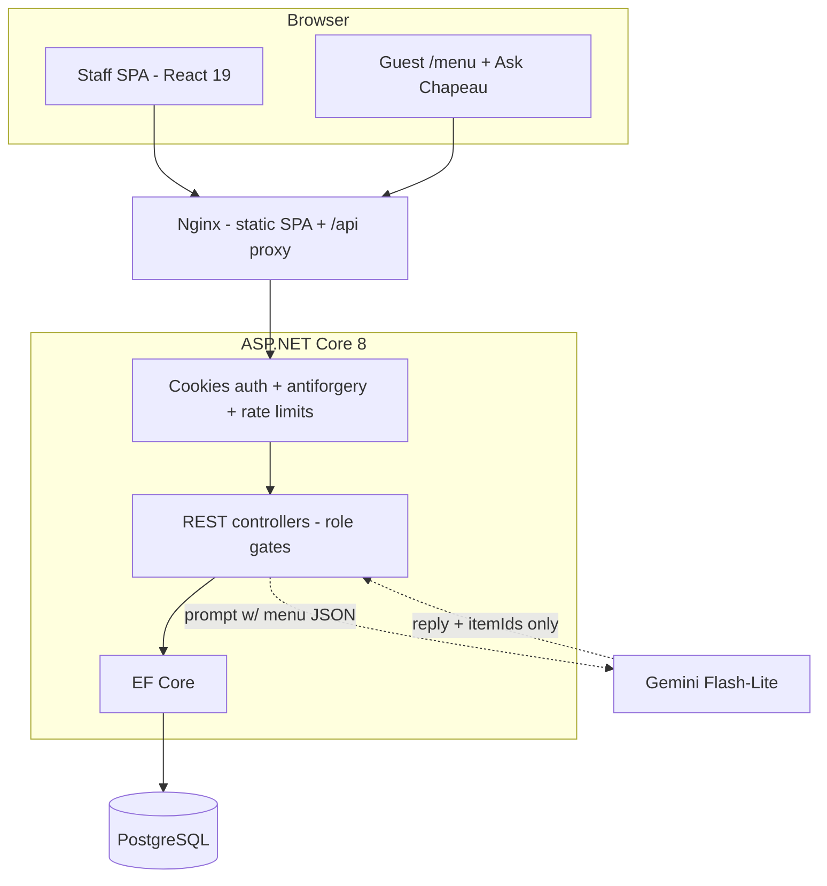

# Chapeau — Restaurant POS & Ordering Platform

> Started as an unfinished five-person university project (WinForms + SQL Server). After the course ended, I rebuilt it solo into a full-stack restaurant platform: a React 19 SPA for staff and guests, a layered ASP.NET Core 8 API, EF Core, PostgreSQL in Docker, and a Gemini-powered menu assistant that proposes but never disposes.

**Live deployment:** http://149.118.68.3 — a Docker Compose stack (PostgreSQL + API + Nginx) running on my own server. It is up when my machine is up.
**Offline demo:** no backend needed — `cd frontend && npm install && npm run demo`, open `http://localhost:5173/menu`. The demo mode intercepts API calls with scripted in-browser mocks.

**Demo sign-in PINs** (same seed on the live instance and in demo mode):

| PIN | Role |
| --- | --- |
| 1234 | Waiter |
| 3456 | Chef |
| 4567 | Bartender |

---

## What it does now

| | |
| --- | --- |
|  |  |
| *Guest menu: descriptions, allergen chips, basket* | *Waiter: floor overview, live table states* |
|  |  |
| *Kitchen: per-item prep queue with notes and waiting times* | *Ask Chapeau: grounded, allergen-aware recommendations* |

**Staff side:** waiters open tables and take orders, the kitchen and bar each work their own item queue, every order item moves through `Running → Preparing → Prepared → Served`, and checkout is gated until everything is served.

**Guest side:** `/menu` is a public, no-login page — browse, add to basket with notes, enter your table number, and the order lands in the staff flow (staff must open the table first; a table with an open order is rejected with a 409).

**AI assistant:** *Ask Chapeau* answers menu questions and proposes dishes as pick cards. Guests still confirm everything in their own basket — the assistant cannot place an order.

**Three things to try on the live deployment:**

1. Ask the assistant *"I'm allergic to nuts — which dessert can I have?"* — it answers from the ingredients data for the menu and still asks you to confirm with your server.
2. Add the same dish twice with different notes — the basket splits them into separate lines (notes are part of the line identity).
3. Try to check out an order whose items aren't served yet — the API rejects it (`Items must be served`).

## The story

The original *Project Chapeau* was a course team project — five of us built a WinForms restaurant system on SQL Server with the classic UI / Service / DAL / Model layout. The course ended with the business flows incomplete: there was no way to create an order end-to-end, no checkout flow, and the "bill" existed as an unbound ID on a model.

This repository is what came after: the same restaurant, rebuilt by me alone as a web platform. I kept the original code in the repository on purpose — `ChapeauDAL/`, `ChapeauModel/`, `ChapeauService/`, `ChapeauUI/` are the "before" exhibit, and `docs/refactoring.md` contains the full before/after comparison this README summarises.

## The rebuild

| | Before (course version) | After (this repo) |
| --- | --- | --- |
| Structure | Layered in name (UI / Service / DAL / Model) | Core / Infrastructure / API, plus an independent React SPA |
| Data access | Hand-written ADO.NET (`SqlDataAdapter`, per-DAO `SqlConnection`) | EF Core, SQLite for dev, PostgreSQL for deployment, migrations in a dedicated project |
| Sign-in | User code, hashed, checked per click, role → WinForms forms | PIN → cookie session (`HttpOnly`, `SameSite=Strict`), per-role `[Authorize]`, antiforgery on all mutating requests |
| Tables | View tables, set status by hand | Status derived from orders: opening an order occupies a table, checkout frees it |
| Orders | Read-only lists; item-level data flattened into one model | Create orders & items, transactional stock checks, unit price captured at order time |
| Kitchen / bar | One shared list, any status change | Separate queues, category-based routing, state machine enforced server-side |
| Checkout | `BillId` on a model, no flow | Served-gated billing: payment method, amount, tip, table release — in one atomic save |
| Guests & AI | — | Public `/menu` with basket, first-order submission with batch stock validation, grounded menu assistant |

Two findings shaped how I think about this rewrite — both are visible in the original code:

**1. The problem was inconsistent boundaries, not a missing architecture.**
The old project *had* layering, and even parameterised SQL. The failure was enforcement. In the shared order overview, the UI loads data through the layer it should go through *and* around it, two lines apart:

```csharp
// ChapeauUI/Orders.cs
SortAndDisplayOrders(...)  // goes through OrderService
...
orders = new OrderDao().GetAllOrders();  // bypasses the service layer entirely
```

So the rewrite is less "no architecture → architecture" and more "the boundaries existed only by convention → make the boundary the only path in". Role authorization, DTOs, and the server-side state machine are that path now.

**2. The order model was the real blocker.**
The old `Order` carried order-level and dish-level fields in one class — with no unit price:

```csharp
// ChapeauModel/Order.cs (abridged)
public int TableId { get; set; }
public OrderStatus Status { get; set; }   // one status for the whole order
public int MenuItemId { get; set; }       // one row per dish
public int Count { get; set; }
public int BillId { get; set; }           // never used
```

One order, one status, zero prices. The rewrite splits it into `Order` (table, employee, paid state) and `OrderItem` (dish, count, notes, **prep status**, **unit price at order time**) — which is what makes per-item food queues, "one dish is being prepared while the next is already served", and billing at the price the guest actually saw, possible.

## Three design decisions

**1. Every order line is its own state machine, owned by a role.**
The kitchen may move an item `Running → Preparing → Prepared`; the bar has its own subset; nobody walks states backwards, and the server rejects anything outside the map with a 409 instead of silently overwriting:

```csharp
bool isAllowedTransition =
    (orderItem.Status == OrderStatus.Running  && request.Status == OrderStatus.Preparing) ||
    (orderItem.Status == OrderStatus.Preparing && request.Status == OrderStatus.Prepared);
if (isAllowedTransition is false) return Conflict();
```

**2. Checkout closes the loop — atomically.**
Billing requires every item `Served`, computes the total from the *stored* unit prices, validates amount and tip by hand (non-negative, ≤ 2 decimals), records payment method and time, then marks the order paid and frees the table in one `SaveChangesAsync` — the three writes succeed together or not at all.

**3. A network timeout is not an answer.**
The guest order flow classifies every submission as `submitted`, `rejected` (the backend explained why: stock, table already open, …) or **`uncertain`** (no response at all). On `uncertain` the client tells the guest *"we could not confirm whether your order was received — check with your server before ordering again"* and keeps the basket, instead of lying with a success screen or silently re-submitting and double-ordering.

## Architecture



Docker Compose runs PostgreSQL, the API, and the Nginx-fronted SPA. Development uses SQLite (`DatabaseProvider` switches), schema migrations live in a dedicated `Chapeau.Migrations.Postgres` project. Guest endpoints and the assistant are anonymous but rate-limited; staff endpoints carry role gates end to end.

## Running it

```bash
# offline demo (no backend at all)
cd frontend
npm install
npm run demo            # scripted in-browser API, http://localhost:5173

# full stack in Docker
cp .env.example .env.local 2>/dev/null || true   # set GEMINI_API_KEY for compose.server.yaml
docker compose -f compose.local.yaml up -d --build

# plain dev
dotnet run --project src/Chapeau.Api     # SQLite database
cd frontend && npm install && npm run dev
```

## The AI assistant

`Ask Chapeau` is deliberately small: one stateless call per question, the whole menu (in-stock items only) injected into the prompt, and a JSON schema forcing the model to answer `{"reply": ..., "menuItemIds": [...]}` — the client renders picks as cards, and nothing is ordered anywhere near the model.

What I paid attention to, and would talk about in an interview:

- **Grounding over guessing.** Recipe and allergen data ships as one tracked JSON file (`data/menu-details.json`) consumed by both the API (prompt enrichment) and the SPA (dish details). With that context the assistant can say *"the Tiramisu is a lovely way to finish up — please confirm with your server before ordering if you need to avoid nuts"*: an answer built on listed ingredients, never a claim of allergy-safety.
- **Allergen rules are explicit prompt logic.** Missing data means unknown; an empty allergens list is not "allergen-free"; items listing the allergen the guest asks to avoid are not recommended; cross-contact is always deferred to the server.
- **The backend disposes.** Recommended IDs are validated against the menu on the server; prices, stock and totals are computed from the database, never from model text.
- **Cost is measured, not hand-waved.** A turn is ~1,000 prompt tokens (menu JSON) + ~50 output tokens — about US$0.0001 at Flash-Lite pricing, comfortably inside Gemini's free tier for a demo. I chose structured JSON output over tool-calling because a ~40-item menu fits the prompt; a retrieval tool would only add failure modes.
- **Scope honesty.** The request plumbing (HTTP envelope, schema plumbing, controller error mapping) was implemented with AI agents under review; the guardrails, data shape and cost discipline are the parts I designed. The live assistant banner says "One question at a time" because the endpoint is stateless by design.

## Scope & limitations

Deliberate scope, not oversights:

- **Payments are recorded, not processed.** The bill stores payment method, amount and tip; no payment provider is integrated.
- **Guests submit first orders only.** Additions to an open order go through a waiter by design — the table owner is a human.
- **The assistant only proposes.** It reads `Stock > 0` items and never touches orders; recommended IDs are currently rejected-strictly if unknown (a stricter graceful filtering is on the roadmap).
- **Four-digit PINs, publicly documented.** This is an internal-restaurant threat model, not a public SaaS; the trade-off (no rate limiter on login) is a known gap that a public deployment should revisit.
- **Recipe data is illustrative.** `dataStatus` inside the JSON says exactly that, and the assistant relays it.

## What's next

- Move recipe/allergen columns into the menu tables via an EF migration and drop the JSON mirror.
- Graceful ID filtering (drop unknown picks, keep the reply) in the assistant.
- Login rate limiting — mandatory before this would ever be deployed anywhere public.
- SignalR for kitchen/tables instead of polling; exception report automation.

## Credits

- **Original course project** by a five-person team: Puok, Can, Laith, Bogdan and Bader — their WinForms code is preserved in this repository (`ChapeauDAL/`, `ChapeauModel/`, `ChapeauService/`, `ChapeauUI/`).
- **Rebuild, API, SPA and deployments** — this repository's owner.
- AI-assisted development: UI layer and assistant plumbing were produced with AI coding agents under review; architecture, business rules and security logic were hand-built.
