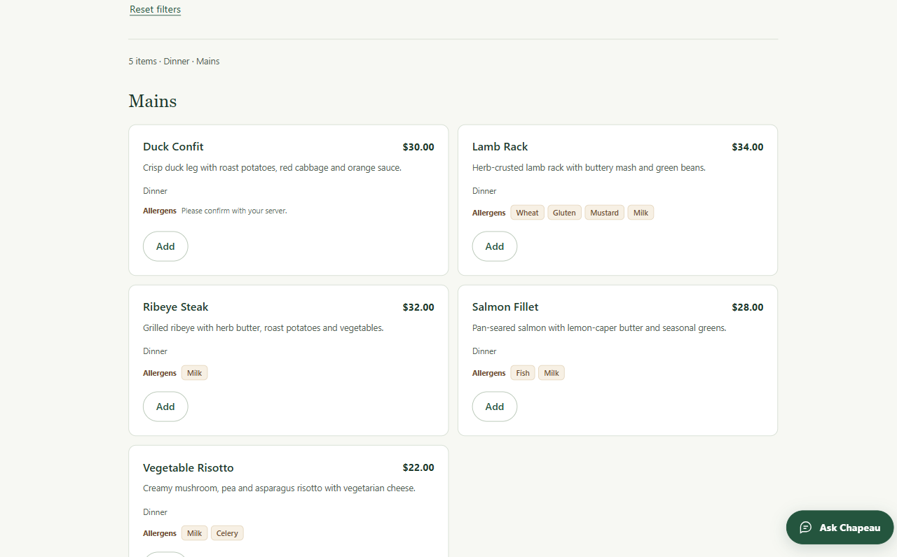
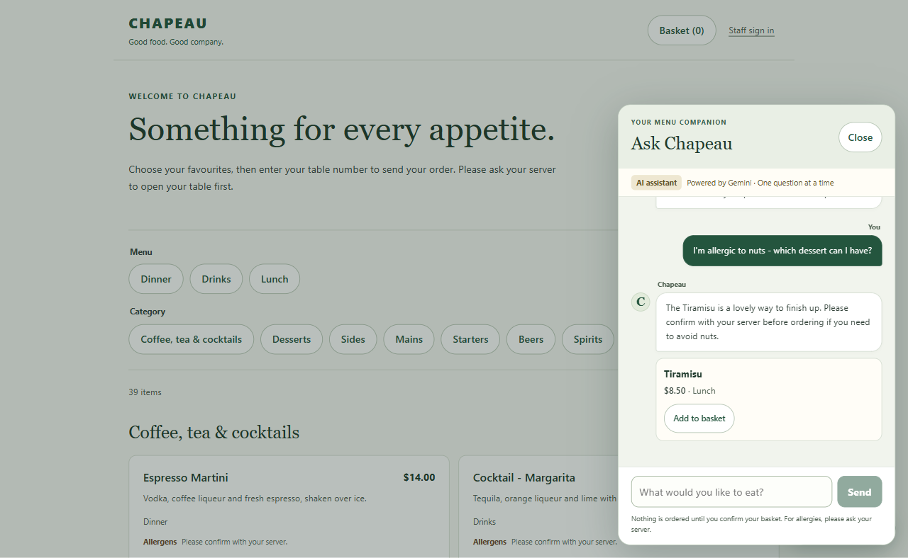
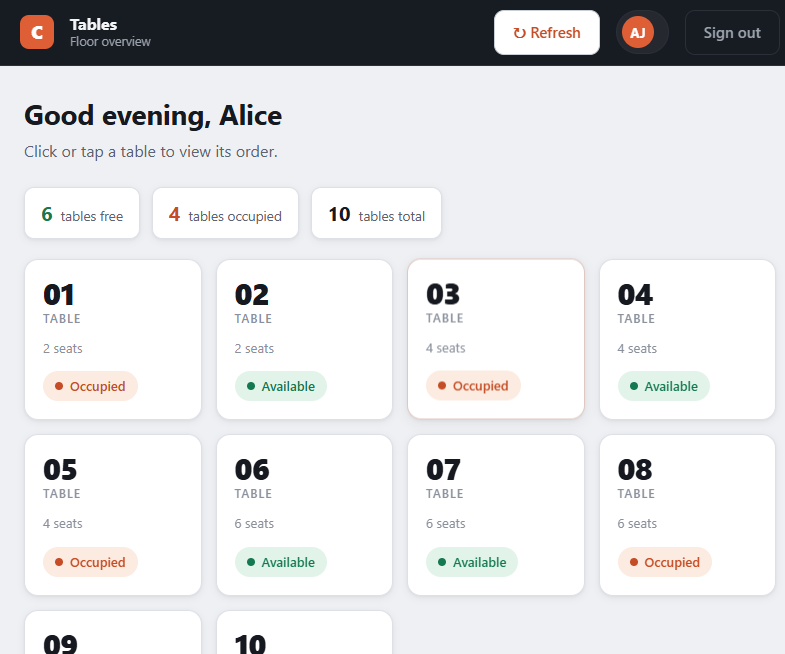
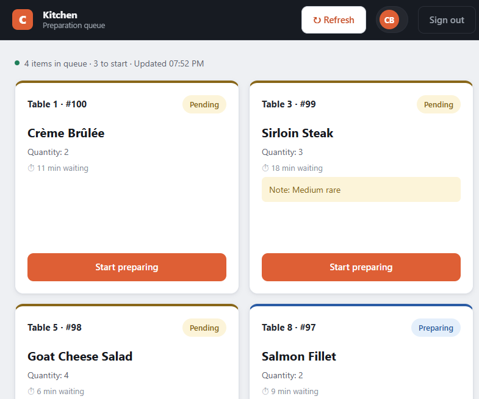
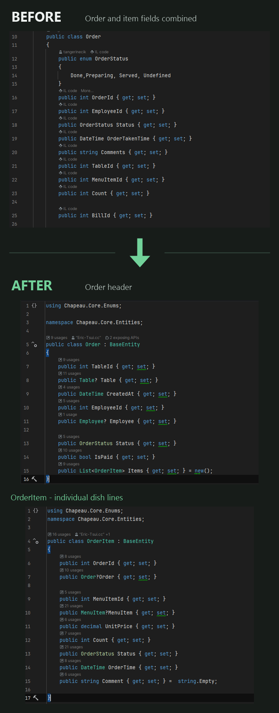
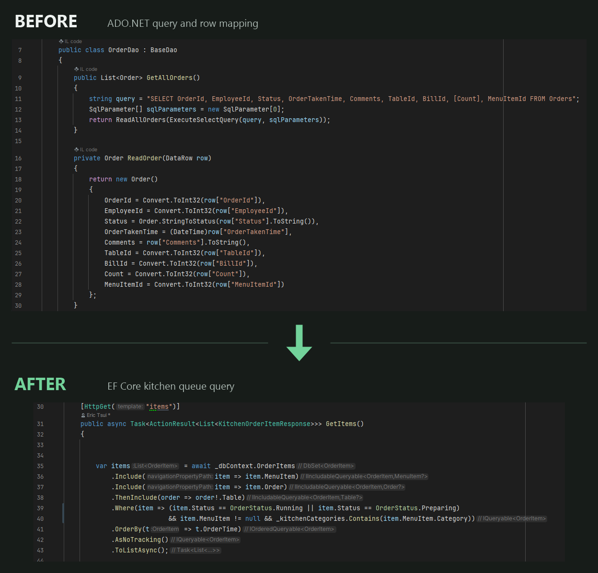
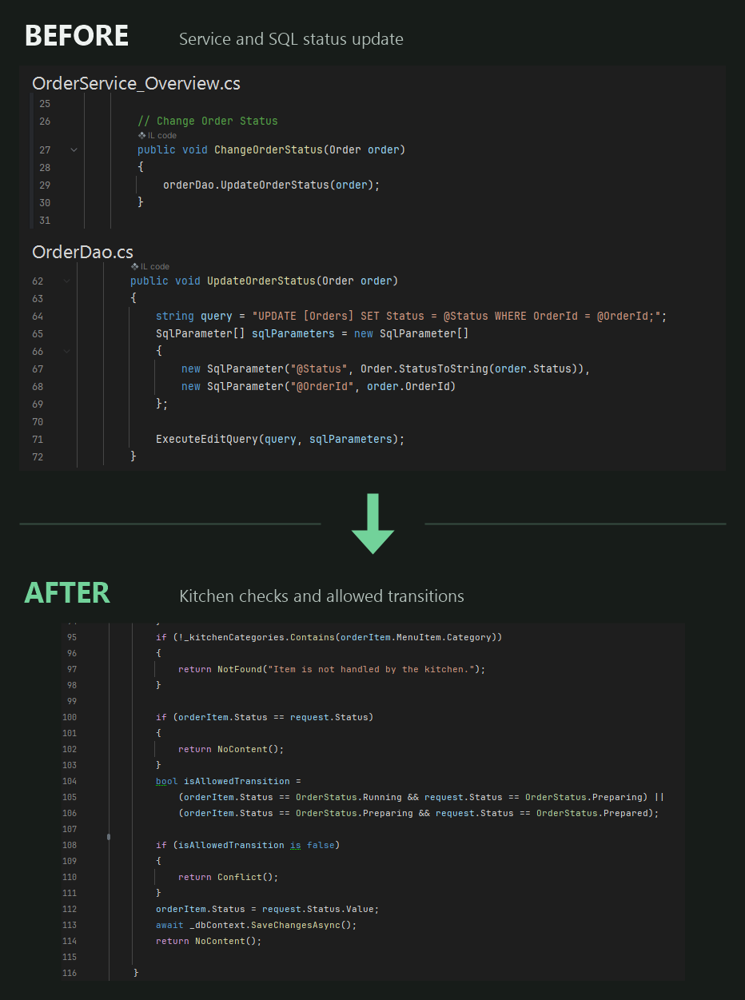
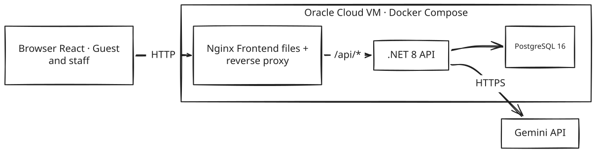

<div align="center">


[](https://dotnet.microsoft.com/)
[](https://react.dev/)
[](https://www.typescriptlang.org/)
[](https://www.postgresql.org/)
[](https://www.docker.com/)

</div>

Chapeau started as an unfinished five-person university project: a WinForms restaurant POS connected to SQL Server. After the course ended I rebuilt it on my own as a web platform, and used it to work through the problems the old version never solved. The original WinForms code is still in the repo (`ChapeauUI/`, `ChapeauService/`, `ChapeauDAL/`, `ChapeauModel/`), so everything old and new is in one place.
## 🚀 Quick Start
- **Live deployment:** [Guest menu](http://149.118.68.3/menu) · [Staff sign in](http://149.118.68.3/staff/login) — hosted on an Oracle Cloud VM with Docker Compose
- **Offline demo:** `cd frontend && npm install && npm run demo`, then open http://localhost:5173/menu — no backend, the API calls are mocked in the browser

> [!TIP]
> ### Demo sign-in PINs
>
> **Waiter — `1234` or `2345`**
>
> **Chef — `3456`**
>
> **Bartender — `4567`**
>
> Enter a PIN on the staff sign-in page to open that role's workspace. Guests can browse the menu without signing in.

## 📸 What it looks like

### Guest experience

Browse the public menu at `/menu`, add dishes with per-line notes, and submit the first order to a table opened by a waiter. Ask Chapeau offers menu suggestions alongside the basket.


<details>
<summary>View menu and assistant screenshots</summary>

<p>
  <a href="docs/images/customer-menu.png"></a>
  <a href="docs/images/customer-assistant.png"></a>
</p>

</details>

### Staff workflow

Waiters manage tables and orders; the kitchen and bar have separate preparation queues. Once every item is served, checkout records the payment and frees the table.


<details>
<summary>View table overview and kitchen screenshots</summary>

<p>
  <a href="docs/images/waiter-tables.png"></a>
  <a href="docs/images/kitchen.png"></a>
</p>

</details>

<sub>Click an animation or screenshot to view it at full size.</sub>

One thing worth trying on the live site: ask the assistant "I'm allergic to nuts — which dessert can I have?" It answers from the ingredient data and still tells you to confirm with your server before ordering.

## 📂 What the repo looks like

The course project and the rebuild live in the same repository on purpose. Here is how they compare:

### 🕰️ Before — the course project

```text
Chapeau/
├── 📄 Project Chapeau.sln
├── 📂 ChapeauModel/               # 3 entity classes
│   ├── 📄 Order.cs                # order + order line merged into one
│   ├── 📄 Employee.cs
│   └── 📄 Table.cs
├── 📂 ChapeauDAL/
│   ├── 📄 BaseDao.cs              # raw ADO.NET, shared SqlConnection
│   ├── 📄 OrderDao.cs
│   ├── 📄 TableDao.cs
│   └── 📄 EmployeeDao.cs
├── 📂 ChapeauService/
│   ├── 📄 IfCorrectChecker_Bogdan.cs   # files named after team members
│   ├── 📄 OrderService_Overview.cs
│   └── 📄 TableService_Bogdan.cs
└── 📂 ChapeauUI/                  # WinForms, one form per screen
    ├── 📄 LoginPage.cs
    ├── 📄 Orders.cs
    ├── 📄 Tables.cs
    └── 📄 ChapeauUI.cs
```

### 🔨 After — the rebuild

```text
Project-Chapeau/
├── 📂 src/
│   ├── 📂 Chapeau.Core/            # entities + enums shared by every layer
│   ├── 📂 Chapeau.Infrastructure/  # EF Core data access, Gemini assistant
│   ├── 📂 Chapeau.Api/             # REST controllers, cookie auth, rate limits
│   └── 📂 Chapeau.Migrations.Postgres/  # versioned database migrations
├── 📂 frontend/                    # React 19 SPA
│   ├── 📂 src/api/                 # typed API client
│   ├── 📂 src/components/          # shared + staff + customer UI
│   ├── 📂 src/pages/               # staff screens + public /menu
│   ├── 📂 src/demo/                # scripted in-browser API mock
│   ├── 📂 src/lib/                 # cart, menu details, formatting
│   └── 📂 src/types/
├── 📂 data/
│   └── 📄 menu-details.json        # allergen/ingredient data for prompt + SPA
├── 📄 compose.local.yaml           # local Docker environment
├── 📄 compose.server.yaml          # server deployment: PostgreSQL + API + Nginx
├── 📄 Dockerfile.api
└── 📄 Dockerfile.frontend
```

The old version already separated UI, services, data access and models, but some UI code bypassed the service layer and called a DAO directly. The rebuild separates entities, data access, HTTP endpoints and schema migrations, and adds a React frontend. Business checks currently live mainly in controllers; a separate application-service layer would be a further improvement.

## 📜 What the old version looked like

The course version had the standard UI / Service / DAL / Model folders and even used parameterised SQL, so it wasn't missing architecture on paper. The problems were in the details:

- The UI sometimes bypassed the service layer when it was convenient.
- The `Order` class mixed order-level and dish-level fields, without a separate order header and collection of items. Each record held a status but no captured unit price.
- There was no way to create an order end to end, no checkout implementation, and `BillId` sat on the model without anything ever using it.
- The shared order screen had a combo box where any status could be set on any row.

Full comparison with quoted code: [docs/refactoring.md](docs/refactoring.md).

## 🔧 What I changed and why

The rebuild combines a change of platform with changes to the model and business rules. These three examples show what changed in the code; the checkout flow below was added to complete the unfinished system.

### 1. Separate an order from its individual items

The old `Order` class held both order-level fields, such as the table and employee, and line-level fields, such as `MenuItemId`, quantity and comments. The rebuild separates these responsibilities: `Order` holds the table, responsible employee, creation time and payment state, while its `Items` collection contains an `OrderItem` for each line.



[View the side-by-side comparison](docs/images/order-model-before-after.png)

Each item now has its own preparation status, note and `UnitPrice` captured when it is added. This lets the kitchen and bar handle items independently and lets checkout calculate the subtotal from the prices recorded at ordering time, even if the menu price later changes.

### 2. Replace ADO.NET mapping with asynchronous EF Core queries

The old `OrderDao` loads all order records with a SQL string and manually converts each `DataRow` into an `Order`. The new kitchen endpoint uses EF Core to load related entities and filter by preparation status and kitchen category, ordered by the time each item was placed.



[View the side-by-side comparison](docs/images/data-access-before-after.png)

These queries serve different scopes: the old example is a general order overview, while the new one is a kitchen queue. The technical change is from synchronous ADO.NET calls and column-by-column entity mapping to `Include`, LINQ filtering, `AsNoTracking` and `ToListAsync`. The API still explicitly maps the resulting entities to response DTOs; database entities and HTTP responses have different responsibilities.

### 3. Validate status transitions before saving

In the old update path, the service delegates to a DAO that writes the supplied status to SQL Server. The new kitchen endpoint checks that the item exists, belongs to a kitchen category and can move from its current state to the requested state before saving with EF Core.



[View the full side-by-side comparison](docs/images/status-update-before-after.png) · [Read the complete endpoint](src/Chapeau.Api/Controllers/KitchenController.cs)

The kitchen allows `Running → Preparing → Prepared`. Repeating the current status returns `204` without another change; an unsupported transition returns `409`. Invalid requested statuses return `400`, and missing items or items handled by another station return `404`. The bar has its own endpoint for moving drinks from `Running` to `Prepared`, and waiters mark prepared items as served.

### Completing the workflow

Checkout is an addition to the unfinished course project, rather than a rewrite of an existing checkout implementation. An order must contain items, remain unpaid and have every item served before it can be billed. The default amount comes from stored unit prices, with an optional amount override. Saving the bill, marking the order paid and freeing the table happen in one `SaveChangesAsync` call. This records a payment received by staff; it does not process a payment through a provider.

Guest orders handle failure honestly. If the API answers, the guest sees submitted or rejected with the reason. If the connection drops before an answer, the frontend counts the submission as uncertain, tells the guest it can't confirm whether the order arrived, and keeps the basket rather than auto-resending and risking a double order.

## 🏗️ Architecture



[Editable Excalidraw source](docs/images/Architecture.excalidraw)

Docker Compose runs PostgreSQL, the API, and the Nginx-served frontend. Development uses SQLite and switches to Postgres through a `DatabaseProvider` setting. SQLite migrations live in `Chapeau.Infrastructure`; PostgreSQL migrations live in `Chapeau.Migrations.Postgres`. Guest menu, ordering and assistant endpoints allow anonymous access; the assistant has a request rate limit. Staff operations require authentication, with role checks on waiter, kitchen and bar endpoints.

## 🚀 Running it

```bash
# offline demo, no backend
cd frontend
npm install
npm run demo

# full stack in Docker
docker compose -f compose.local.yaml up -d --build   # set GEMINI_API_KEY for the assistant

# plain development
dotnet run --project src/Chapeau.Api     # SQLite
cd frontend && npm install && npm run dev
```

## 🤖 The AI assistant

Ask Chapeau is a small feature and I kept it that way: one stateless call per question, the in-stock menu injected into the prompt, and a JSON schema forcing the model to return `{reply, menuItemIds}`, which the frontend renders as pick cards. Guests confirm everything in their own basket; the assistant can't place an order.

The part I designed myself is the guardrail layer: recipe and allergen data ships as one tracked JSON file (`data/menu-details.json`) used by both the prompt and the dish details on the frontend, missing data means "unknown" rather than "safe", an empty allergen list is never presented as allergen-free, items listing the guest's allergen are not recommended, and cross-contact questions always go to a human. The HTTP plumbing, schema setup, and error mapping around that were built with AI coding agents and then reviewed against this list, which is roughly the split I'd describe in an interview.

Cost-wise it's about 1,000 prompt tokens per question, well under a tenth of a cent on Flash-Lite and within the free tier, which is also why I chose a full-menu prompt over a retrieval tool for a 40-item menu.

## 🧭 Project context and development

This is a personal learning and portfolio project, not a system intended to run a real restaurant. I returned to an unfinished course project so I could work with a familiar business problem while learning how to build and deploy a web application. The focus is backend development: modelling orders, enforcing business rules, designing HTTP endpoints and managing data. The React frontend makes those workflows usable and gives visitors a way to try them.

I started the rebuild in July 2026 and worked on it intermittently over roughly four months, alongside my studies and a part-time job. The milestones below are based on the repository’s commit history:

- **July–August 2026:** rebuilt the entities and EF Core data layer, added migrations and demo data, and implemented the first table, menu and login endpoints.
- **September 2026:** completed order creation, item preparation, serving and checkout, including stored order-item prices; started the React frontend at the end of the month.
- **October 2026:** connected the staff screens, added cookie authentication, role checks and CSRF protection, then implemented customer ordering and the Gemini assistant.
- **Late October 2026:** added PostgreSQL migrations and Docker deployment, put the application on an Oracle Cloud VM, and prepared the demos and before-and-after comparisons in this README.

The menu, employees and recipe details are demonstration data. Ingredient and allergen information is illustrative, not a verified restaurant recipe catalogue. The checkout flow records a payment received by staff; it does not charge a card or connect to a payment provider.

## 🙏 Credits

The original course project was built by a five-person team: Puok, Can, Laith, Bogdan and Bader. Their WinForms code is preserved untouched in this repository. The rebuild, the web API, the frontend, and the deployment are my work, Codex and OpenCode used for parts of the UI layer and assistant plumbing as noted above.


